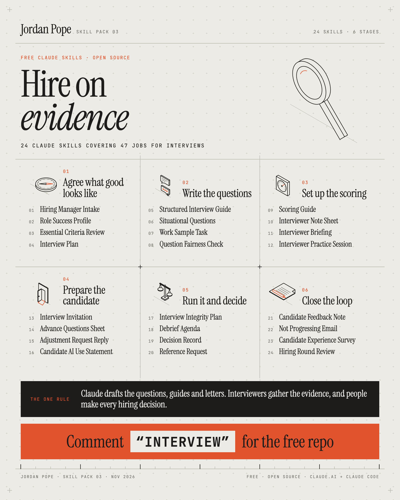

# Hire on evidence: 24 free Claude skills for hiring interviews



For talent acquisition partners, recruiters and HR advisers in the UK who run interviews and get
hiring managers ready for them. The skills cover the interview from start to finish: the intake
with the hiring manager, a structured interview guide with the same questions for everyone, a
scoring guide that says what a strong answer contains before anyone interviews, a reply to an
adjustment request that never asks for a diagnosis, and the decision record you'd be happy for a
candidate to read. Most also check a draft you already have. Free and open source.

**The one rule:** Claude drafts the questions, guides and letters. Interviewers gather the evidence, and people make every hiring decision.

## What's inside

24 skills in 6 stages, in the order the work happens. Each skill drafts one document, and 23 of
them also check one.

<!-- skills-table:start -->

### 01 · Agree what good looks like

| # | Skill | What it produces | Upload file |
| --- | --- | --- | --- |
| 01 | [Hiring Manager Intake](skills/hiring-manager-intake/SKILL.md) | The scoping conversation: what this hire must do in year one, and what the job doesn't need. | [hiring-manager-intake.zip](dist/hiring-manager-intake.zip) |
| 02 | [Role Success Profile](skills/role-success-profile/SKILL.md) | Four to six criteria, each tied to real work, agreed before the first candidate. | [role-success-profile.zip](dist/role-success-profile.zip) |
| 03 | [Essential Criteria Review](skills/essential-criteria-review/SKILL.md) | Finds essential criteria that shut people out without a job reason, and rewrites them. | [essential-criteria-review.zip](dist/essential-criteria-review.zip) |
| 04 | [Interview Plan](skills/interview-plan/SKILL.md) | Who assesses which criterion at which stage, so each one is tested once and properly. | [interview-plan.zip](dist/interview-plan.zip) |

### 02 · Write the questions

| # | Skill | What it produces | Upload file |
| --- | --- | --- | --- |
| 05 | [Structured Interview Guide](skills/structured-interview-guide/SKILL.md) | The same questions in the same order for everyone, with probes and timings. | [structured-interview-guide.zip](dist/structured-interview-guide.zip) |
| 06 | [Situational Questions](skills/situational-questions/SKILL.md) | What-would-you-do questions built from the real dilemmas in the job. | [situational-questions.zip](dist/situational-questions.zip) |
| 07 | [Work Sample Task](skills/work-sample-task/SKILL.md) | A short task that mirrors the job and is hard to fake, with a marking guide. | [work-sample-task.zip](dist/work-sample-task.zip) |
| 08 | [Question Fairness Check](skills/question-fairness-check/SKILL.md) | Flags unlawful, leading or insider-friendly questions and rewrites them. | [question-fairness-check.zip](dist/question-fairness-check.zip) |

### 03 · Set up the scoring

| # | Skill | What it produces | Upload file |
| --- | --- | --- | --- |
| 09 | [Scoring Guide](skills/scoring-guide/SKILL.md) | What a weak, sound and strong answer looks like for each criterion, before anyone interviews. | [scoring-guide.zip](dist/scoring-guide.zip) |
| 10 | [Interviewer Note Sheet](skills/interviewer-note-sheet/SKILL.md) | A sheet that captures what the candidate said and did, kept apart from impressions. | [interviewer-note-sheet.zip](dist/interviewer-note-sheet.zip) |
| 11 | [Interviewer Briefing](skills/interviewer-briefing/SKILL.md) | One page for the panel: roles, timings, questions to avoid, scoring alone first. | [interviewer-briefing.zip](dist/interviewer-briefing.zip) |
| 12 | [Interviewer Practice Session](skills/interviewer-practice-session/SKILL.md) | A 60-minute session where hiring managers practise asking, probing and scoring. | [interviewer-practice-session.zip](dist/interviewer-practice-session.zip) |

### 04 · Prepare the candidate

| # | Skill | What it produces | Upload file |
| --- | --- | --- | --- |
| 13 | [Interview Invitation](skills/interview-invitation/SKILL.md) | Date, format, panel and what to expect, with a plain way to ask for adjustments. | [interview-invitation.zip](dist/interview-invitation.zip) |
| 14 | [Advance Questions Sheet](skills/advance-questions-sheet/SKILL.md) | The questions or themes you share ahead, sent the same way to every candidate. | [advance-questions-sheet.zip](dist/advance-questions-sheet.zip) |
| 15 | [Adjustment Request Reply](skills/adjustment-request-reply/SKILL.md) | A reply that agrees adjustments to the interview without asking for a diagnosis. | [adjustment-request-reply.zip](dist/adjustment-request-reply.zip) |
| 16 | [Candidate AI Use Statement](skills/candidate-ai-use-statement/SKILL.md) | What AI use is fine in your process, what isn't, and how the interview checks. | [candidate-ai-use-statement.zip](dist/candidate-ai-use-statement.zip) |

### 05 · Run it and decide

| # | Skill | What it produces | Upload file |
| --- | --- | --- | --- |
| 17 | [Interview Integrity Plan](skills/interview-integrity-plan/SKILL.md) | Proportionate checks for stand-in candidates and live AI help, the same for everyone. | [interview-integrity-plan.zip](dist/interview-integrity-plan.zip) |
| 18 | [Debrief Agenda](skills/debrief-agenda/SKILL.md) | Scores in before anyone talks, then criterion by criterion, with the decision written down. | [debrief-agenda.zip](dist/debrief-agenda.zip) |
| 19 | [Decision Record](skills/decision-record/SKILL.md) | Why the panel decided, criterion by criterion, ready for a subject access request. | [decision-record.zip](dist/decision-record.zip) |
| 20 | [Reference Request](skills/reference-request/SKILL.md) | Reference questions tied to the criteria, asked with the candidate's consent. | [reference-request.zip](dist/reference-request.zip) |

### 06 · Close the loop

| # | Skill | What it produces | Upload file |
| --- | --- | --- | --- |
| 21 | [Candidate Feedback Note](skills/candidate-feedback-note/SKILL.md) | Specific, kind feedback written from the panel's evidence and decision. | [candidate-feedback-note.zip](dist/candidate-feedback-note.zip) |
| 22 | [Not Progressing Email](skills/not-progressing-email/SKILL.md) | Prompt, human messages for each stage, so no candidate is left waiting. | [not-progressing-email.zip](dist/not-progressing-email.zip) |
| 23 | [Candidate Experience Survey](skills/candidate-experience-survey/SKILL.md) | A short survey after interview on what it was like and what to fix. | [candidate-experience-survey.zip](dist/candidate-experience-survey.zip) |
| 24 | [Hiring Round Review](skills/hiring-round-review/SKILL.md) | A look back at one round in aggregate: time to hire, drop-off, score spread, consistency. | [hiring-round-review.zip](dist/hiring-round-review.zip) |
<!-- skills-table:end -->

## Install

### Claude.ai or the Claude desktop app (Pro, Max, Team or Enterprise plans)

1. In **Settings › Capabilities**, turn on **Code execution and file creation**. Skills need it.
2. Download **[`hiring-interviews-all-in-one.zip`](dist/hiring-interviews-all-in-one.zip)** for every skill in one upload, or pick single skills from the table above.
3. In **Settings › Capabilities › Skills**, choose **Upload skill** and pick the zip. Upload either the all-in-one zip or single skills; uploading both gives Claude two copies of each skill.
4. Start a new chat and ask for the document, for example: *"Write a structured interview guide for a team leader role in our contact centre, 45 minutes, four criteria."* Claude picks up the skill from your request.

Claude's settings get reorganised from time to time. If the menu names differ, search your settings for "Skills".

### Team and Enterprise admins

Upload the zips once in your organisation's settings under **Skills** and they appear for everyone in the workspace.

### Claude Code

```bash
git clone https://github.com/JordzPope/claude-skills-hiring-interviews.git
cp -R claude-skills-hiring-interviews/skills/* ~/.claude/skills/
```

Copy into a project's `.claude/skills/` folder instead to share them with everyone on that project.

## Try it on Brackenholt Energy first

Every skill comes with sample input from Brackenholt Energy, a 900-person energy supplier with a Sheffield contact centre, smart-meter engineers and a small software team (fictional), with problems planted in it. Install a skill, open a new chat and say *"try it"*: Claude reads the sample, runs its checks and lists what it finds. Compare its list with [`sample-data/answer-key.md`](sample-data/answer-key.md) before any real data goes near it. More about the company and its five open vacancies in [`sample-data/README.md`](sample-data/README.md).

## What the skills are built on

Structured interviews came out as the strongest single predictor of job performance in Sackett
and colleagues' 2022 re-analysis of selection research. The skills build in what "structured"
means in Campion, Palmer and Campion's review: questions taken from the job, the same questions
in the same order, rating scales with anchors, notes, several interviewers, and scoring alone
before anyone discusses a candidate.

## Using these with candidate data

- Check your organisation's AI policy before you add anything about a real candidate.
- Work with roles and letters (Candidate A, B, C). Interview notes, scores and decision records are personal data under UK GDPR, and a candidate can ask to see them.
- No skill scores, ranks, shortlists or decides about a candidate. The scoring guide describes what answers contain; your interviewers do the scoring and your panel makes the decision.
- Every skill drafts. You read and correct the draft before it reaches a candidate or a hiring manager.
- References follow UK practice: the Equality Act 2010 (including section 60 on health questions before an offer, and reasonable adjustments), the EHRC Employment Code, UK GDPR and ICO guidance, and Home Office right to work checks. Check the current versions. None of this is legal advice.

## Feedback

Found a skill that gets something wrong, or want one that isn't here? Open an issue on this repo or message me on [LinkedIn](https://www.linkedin.com/in/vaticanbusiness/).

## About

Made by [Jordan Pope](https://www.linkedin.com/in/vaticanbusiness/). Pack 03 in a free series of Claude skills for HR and L&D teams. Earlier packs: [HR business partners](https://github.com/JordzPope/claude-skills-hr-business-partners) and [training that sticks](https://github.com/JordzPope/claude-skills-training-that-sticks).

Not affiliated with or endorsed by Anthropic. Claude is a trademark of Anthropic.

## Licence

[MIT](LICENSE). Use the skills, change them and share them.
